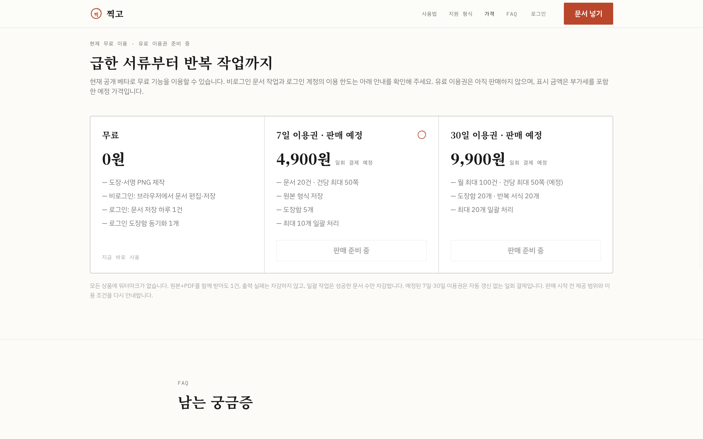

# 찍고

도장·서명을 만들고 PDF·이미지·DOCX·HWPX 문서에 배치하는 웹 도구.

**현재 상태:** 웹 베타 공개 중

[서비스 열기](https://jjikgo.nodeoff.kr/) · [제품 설명](https://nodeoff.kr/products/jjikgo) · [소스 저장소](https://github.com/dhjin1125/jjikgo)

## 개발 환경에서 실행

Node.js 22 이상

```sh
npm ci
npm run dev
```

도장과 문서 편집은 브라우저에서 동작합니다. 계정·보관함 동기화에는 PostgreSQL과 `SESSION_SECRET`, `DATABASE_URL`, `APP_BASE_URL` 설정이 필요합니다. 결제·카카오 로그인은 별도 제공자 설정이 필요합니다. DOCX·HWPX 서식 호환성은 개발 중이며 구형 HWP는 지원하지 않습니다.

## 운영자 정보

- 상호: 노드오프
- 대표: 진동현
- 사업자등록번호: 502-60-03676
- 운영 지역: 인천광역시
- 문의: [jin@nodeoff.kr](mailto:jin@nodeoff.kr)
- 회사 홈페이지: [nodeoff.kr](https://nodeoff.kr)

현재 개발 상태와 공개 주소는 회사 홈페이지와 함께 관리합니다.

## 공개 이력과 개발 경과

2026년 10월 7일 기존 비공개 작업을 정리해 처음 공개한 저장소입니다. 개발 시작일과 공개 커밋 날짜는 다릅니다. [개발 경과와 공개 범위](docs/development-history.md)를 확인해 주세요.

## Screenshot



Captured from the actual public website on 2026-10-07. This is a point-in-time view; sample UI illustrations on the company homepage are labeled as illustrations.

The former sslip.io URL remains available. Browser-local stamps and login cookies do not automatically move between hostnames. Paid passes are not on sale; the checkout endpoint returns SALES_NOT_OPEN.
